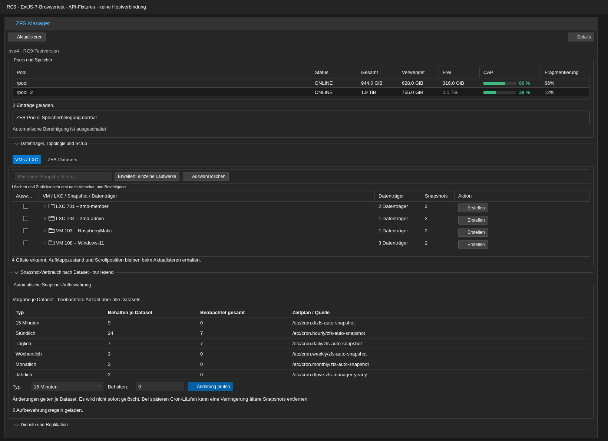

# BuMaVory ZFS Manager für Proxmox VE

ZFS-Pools, VM-/LXC-Snapshots und Aufbewahrung direkt in der vorhandenen
Proxmox-Knotenoberfläche auf Port 8006 verwalten. Unabhängiges Community-Projekt.

[English](README.md) · [RC9-Release](https://github.com/mbuse79/zfs-manager-pve/releases/tag/v1.0.0-34-rc9) · [RC9 installieren](docs/INSTALL-RC9.md) · [Sicherheit](SECURITY.md)

Entwicklung auf diesem Branch: [optionale Clusterinstallation](docs/CLUSTER-INSTALL.md)
mit Knotenauswahl und Bestätigung. Noch nicht im veröffentlichten RC9 enthalten;
reale Clustertests und eine neue Paketfreigabe stehen aus.

## RC10-Testversion / RC10 test package

`1.0.0-34~rc10+fix1`: optionale Clusterinstallation mit geprüfter lokaler Verteilungskopie.
Noch kein öffentlicher Release; reale neue Clustertests stehen aus.
[Deutsche Testanleitung](docs/RC10-TESTANLEITUNG-DE.md).

## RC9: kompakte native Oberfläche

Paketversion **`1.0.0-34~rc9`**. Poolübersicht mit getrennten CAP-/FRAG-Werten,
einklappbare technische Details und die beiden Snapshot-Tabs. Die gemeinsame
Aufbewahrungstabelle unterscheidet Vorgaben je Dataset von der beobachteten
Gesamtsumme. Oberfläche und CLI auf Deutsch und Englisch.

Der Betreiber hat am 15. November 2026 die angeforderten Tests auf der frischen
Test-PVE und dem vorhandenen Host als erfolgreich bestätigt und die Veröffentlichung
beauftragt. Im Entwicklungsverlauf wurden PVE 9.1.1 und 9.2.26 verwendet. 252
unterschiedliche lokale Regressionstests und zusätzliche ExtJS-7-Browsertests mit
API-Fixtures sind dokumentiert. Das ist keine pauschale Freigabe unbekannter
Proxmox-Strukturen oder ein realer Offline-Rettungstest. Siehe [Prüfbericht](RELEASE-QA.md).

## Installation

RC9 wird als **Release Candidate** veröffentlicht. Die vollständige Release-ZIP
verwenden und mit dem geprüften Bootstrap oder `install-local.sh` zunächst
`--check-only` ausführen. Der Weg gilt für Neuinstallation und RC7-/RC8-Upgrade.
**[Anleitung mit Prüfsummenprüfung](docs/INSTALL-RC9.md)**.

Alle PVE-9.x-Versionsnummern werden ohne Minor-/Patch-Rückfrage akzeptiert; echte
Strukturfehler stoppen weiterhin. Keine Freigabe für PVE 8/10. Die ZIP enthält das
unveränderte getestete DEB, Quell-/Builddateien, Installer und die zusätzlichen
Debian-Abhängigkeiten für amd64/all mit Lizenzen und korrespondierenden Quellen.
Keine allgemeinen System-/Proxmox-Upgrades und keine automatische Paketreparatur.
Nicht unterstützte konkurrierende Snapshot-Verwaltungen werden als Konflikt gemeldet.

Der ältere stabile [Release v1.0.0-32](https://github.com/mbuse79/zfs-manager-pve/releases/tag/v1.0.0-32)
bleibt unverändert. `quick-install.sh` zielt weiterhin auf diesen stabilen Release
und ist nicht der Einstieg für RC9. Neuere Manager-Versionen werden nicht herabgestuft.

## Sicherheit und Lizenz

Löschen und Rollback benötigen Vorschau, Berechtigung und Bestätigung. Unabhängige
Backups bereithalten. Aktionen über mehrere Datenträger sind nicht atomar.
Automatische **Notfallbereinigung** ist standardmäßig AUS; vorhandene ausdrückliche
Aktivierungen bleiben erhalten. Die bestehende AutoSnap-Aufbewahrung kann ältere
automatische Snapshots bei späteren Zeitplanläufen entfernen. Snapshot-Verbrauch
ist keine Prognose des durch Löschen freigegebenen Platzes.

Eigene Projektbeiträge: [AGPL-3.0-only](LICENSE). Fremde Rechte bleiben getrennt;
siehe [Drittanbieterhinweise](THIRD_PARTY_NOTICES.md) und [begrenzten Herkunftsvergleich](CODE-PROVENANCE-REVIEW.md).
Kontakt: [BuMaVory Project](mailto:bumavory@buse.rocks).
