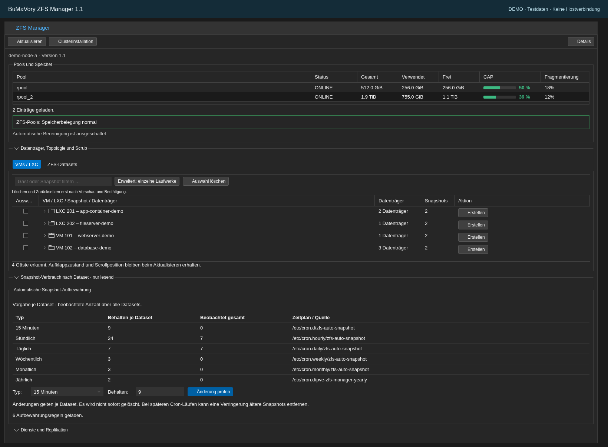
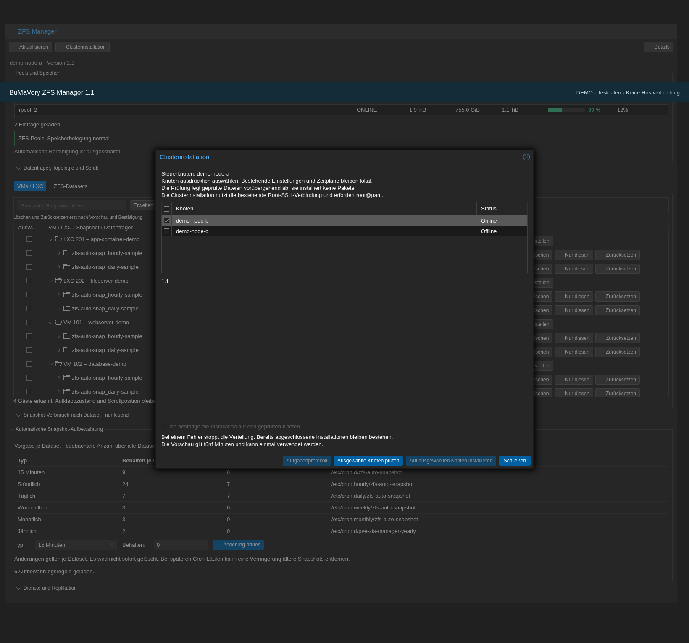

# BuMaVory ZFS Manager für Proxmox VE — 1.1.1

Pools, VM-/LXC-Snapshots und Aufbewahrung in der vorhandenen Proxmox-Oberfläche
auf Port 8006 verwalten. Unabhängiges Community-Projekt.

[English](README.md) · **[Version 1.1.1 herunterladen](https://github.com/mbuse79/zfs-manager-pve/releases/tag/v1.1.1)** · **[Installieren / aktualisieren](docs/INSTALL-1.1.1.md)** · [Clusteranleitung](docs/CLUSTER-INSTALL.md)

*Echter Panelcode mit Testdaten in einem isolierten Browser, kein Produktivhost-Screenshot.*
**[Zweiminütigen Oberflächenrundgang ansehen/herunterladen](docs/media/zfsm-1.1-demo-en.mp4)** · [Deutsche Untertitel](docs/media/zfsm-1.1-demo.de.srt)

| Was du prüfen möchtest | Wo du es findest |
| --- | --- |
| Poolbelegung und Fragmentierung | Getrennte CAP-/FRAG-Übersicht und einklappbare Details |
| Gast-Datenträger und Snapshots | Gruppierte VMs-/LXC-Ansicht und separater Dataset-Tab |
| Bestehende AutoSnap-Aufbewahrung | Vorgaben je Dataset, beobachtete Gesamtzahl und bestätigte Änderungen |
| Weitere Clusterknoten | Bewusste Auswahl, Vorprüfung und bestätigte Installation |

Cluster-Knotenauswahl ansehen (Testdaten)

Neu in 1.1.1: [AutoSnap-Ausschluss je Gast und alle Gast-Snapshots löschen](docs/GUEST-SNAPSHOT-CONTROLS.md). Außerdem: [tägliche Updateprüfung mit bestätigter Installation](docs/UPDATES.md). Die Dataset-Standardansicht blendet Replikationsbereiche aus; Alle anzeigen zeigt den vollständigen Bestand.

## Version 1.1

Kompakte native Oberfläche mit getrennten CAP-/FRAG-Werten, einklappbaren Details,
genau zwei Snapshot-Tabs und einer gemeinsamen Aufbewahrungstabelle. GUI und CLI
auf Deutsch und Englisch.

Optionale Clusterinstallation mit bewusster Knotenauswahl, Vorprüfung und fünf
Minuten gültiger, einmaliger Bestätigung. Die vollständige geprüfte lokale
Paketkopie wird über die bestehende Proxmox-Root-SSH-Anbindung verteilt.
Cluster-Mitgliedsadressen werden vorher eingelesen; unbekannte Adressen führen
zum Abbruch statt zu einem DNS-Fallback. Keine automatische Verteilung,
Konfigurationssynchronisierung oder Installation beim Clusterbeitritt.

Der Betreiber bestätigte die reale Clusterinstallation des Fix2-Vorgängers von
PVE 9.2.26 auf Knoten mit PVE 9.2.26 und 9.2.21. Version 1.1 übernimmt diese
Funktionalität mit neuer Kennzeichnung und Release-Dokumentation. Automatische
Regressionen und DE-/EN-Browsertests: [RELEASE-QA.md](RELEASE-QA.md). Das exakte
1.1-DEB wurde nicht erneut unabhängig auf einem Host installiert. Reale Offline-
Rettung, Abbruch während dpkg und parallele reale Steuerknoten bleiben ungeprüft.

## Installation und Upgrade

Die **vollständige Release-ZIP** mit geprüftem `bootstrap-1.1.sh` verwenden oder
entpacken und zunächst `bash install-local.sh --check-only --lang de` ausführen.
[Anleitung und Prüfsummenprüfung](docs/INSTALL-1.1.1.md).
Eine reine DEB-Installation registriert keine Cluster-Verteilungskopie. Für die
Clusterfunktion deshalb die vollständige ZIP verwenden. Neuere Paketversionen
werden nicht absichtlich herabgestuft. Bei Quellarchiven gilt die versionierte
Anleitung; der Schnellinstaller auf `main` kann nach dem Release geändert werden.

PVE 9.x ohne Minor-/Patch-Rückfrage; echte Strukturprüfungen bleiben erforderlich.
Keine Freigabe für PVE 8/10. Zusätzliche gebündelte Abhängigkeiten für amd64/all.
Keine allgemeinen System-/Proxmox-Upgrades, automatische Paketreparatur oder
stille Ersetzung nicht unterstützter Snapshot-Programme. Einstellungen und
individuelle Zeitpläne bleiben auf jedem Knoten erhalten.

## Rückmeldungen und Kompatibilitätsberichte

[Fehler melden](https://github.com/mbuse79/zfs-manager-pve/issues/new?template=bug_report.yml) ·
[Funktion wünschen](https://github.com/mbuse79/zfs-manager-pve/issues/new?template=feature_request.yml) ·
[PVE-Erfahrung teilen](https://github.com/mbuse79/zfs-manager-pve/issues/new?template=compatibility_report.yml).
Deutsch und Englisch sind willkommen. Plugin-/PVE-Version, Installationsweg,
tatsächlich geprüfte Schritte und anonymisierte Fehlermeldung angeben.
Sicherheitslücken bitte vertraulich gemäß [Sicherheitsrichtlinie](SECURITY.md) melden.

## Sicherheit und Lizenz

Vorschau, Berechtigungen und Bestätigungen vor Löschen/Rollback bleiben erhalten.
Mehrere Datenträger/Knoten werden nicht atomar verändert. Ein Verteilungsfehler
stoppt weitere Installationen; unklare Zielzustände vor Wiederholung prüfen.
Automatische Notfallbereinigung standardmäßig AUS, vorhandene ausdrückliche
Aktivierungen bleiben erhalten. Die bestehende AutoSnap-Aufbewahrung kann bei
Zeitplanläufen ältere automatische Snapshots entfernen. Unabhängige Backups behalten.

Eigene Beiträge: [AGPL-3.0-only](LICENSE); fremde Rechte bleiben getrennt.
[Drittanbieterhinweise](THIRD_PARTY_NOTICES.md) · [Herkunftsvergleich](CODE-PROVENANCE-REVIEW.md).
Kontakt: [BuMaVory Project](mailto:bumavory@buse.rocks).
