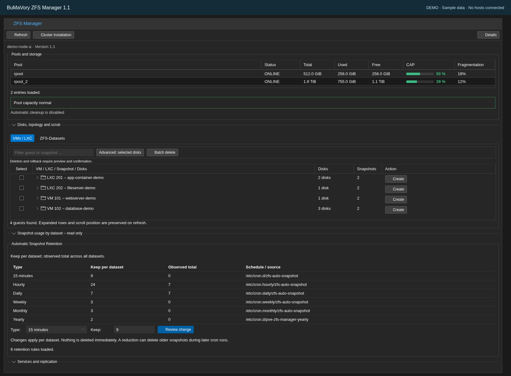
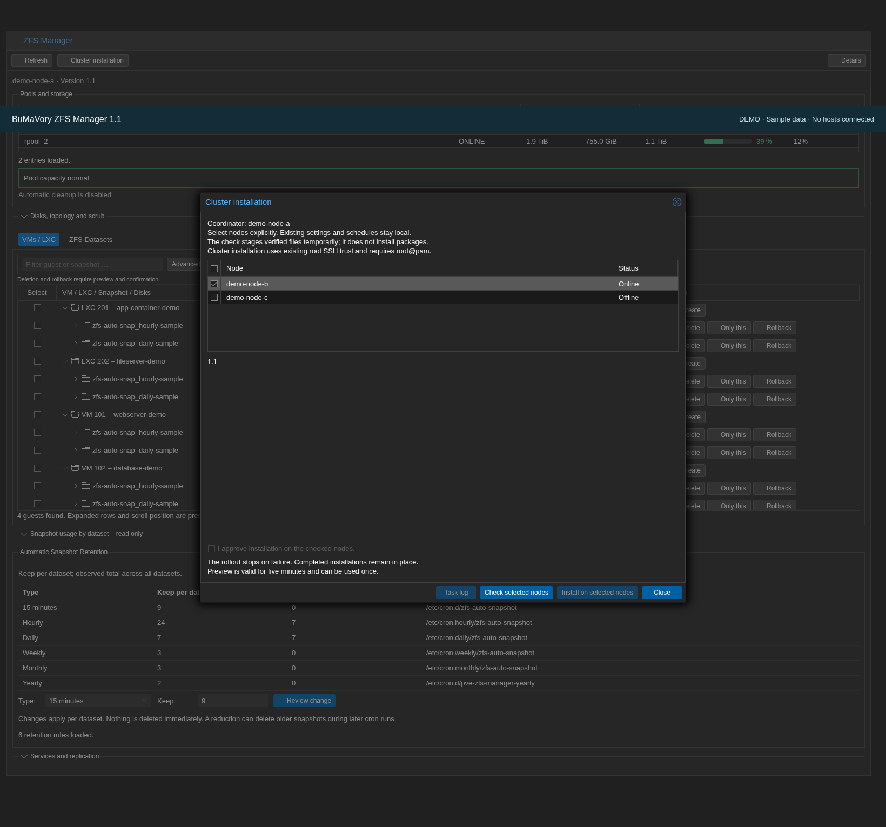

# BuMaVory ZFS Manager for Proxmox VE — 1.1

Manage pools, VM/LXC snapshots and retention in the existing Proxmox node interface
on port 8006. Independent community software, not a Proxmox product.

[Deutsch](README.de.md) · **[Download 1.1](https://github.com/mbuse79/zfs-manager-pve/releases/tag/v1.1)** · **[Install / upgrade](docs/INSTALL-1.1.md)** · [Cluster guide](docs/CLUSTER-INSTALL.md)

*Actual panel code with sample data in an isolated browser, not a production-host screenshot.*
**[Watch/download the two-minute interface tour](docs/media/zfsm-1.1-demo-en.mp4)** · [German subtitles](docs/media/zfsm-1.1-demo.de.srt)

| What you want to inspect | Where to find it |
| --- | --- |
| Pool usage and fragmentation | Separate CAP/FRAG overview and collapsible technical details |
| Guest disks and snapshots | Grouped VMs/LXC view plus a separate dataset tab |
| Existing AutoSnap retention | Per-dataset keep values, observed totals and reviewed changes |
| Another cluster node | Explicit selection, preflight and confirmed installation |

Cluster selection screenshot (sample data)

Development after 1.1: [per-guest AutoSnap exclusion and delete-all snapshots](docs/GUEST-SNAPSHOT-CONTROLS.md). Not included in the existing 1.1 downloads.

## Version 1.1

Compact native UI with separate CAP/FRAG, collapsible details, two snapshot tabs,
and one retention table. GUI and CLI support German and English.

Optional cluster installation uses explicit node selection, staged preflight,
a five-minute single-use preview and confirmation. The complete verified local
bundle is distributed using the existing Proxmox root SSH trust. Cluster member
addresses are refreshed before lookup; unknown addresses cannot fall back to DNS.
No automatic rollout, configuration sync or installation on cluster join.

The operator confirmed the Fix2 predecessor's real cluster rollout from PVE 9.2.26
to PVE 9.2.26 and 9.2.21 nodes. Version 1.1 changes its version identification and
release documentation. Automated regression and DE/EN ExtJS browser results are
recorded in [RELEASE-QA.md](RELEASE-QA.md). The exact 1.1 binary has not had a new
independent host installation test. Offline rescue, interrupted dpkg and concurrent
real coordinators remain unverified.

## Installation and upgrade

Use the **complete release ZIP** and verified `bootstrap-1.1.sh`, or extract the ZIP
and run `bash install-local.sh --check-only --lang en` before installation.
[Full instructions and checksum verification](docs/INSTALL-1.1.md).
A bare DEB does not register the cluster distribution bundle. Use the full ZIP for
cluster deployment. Newer manager versions are never intentionally downgraded.
For archived sources, follow the versioned guide; the quick installer on `main`
can change after the release.

PVE 9.x without minor/patch confirmation; actual structural checks remain required.
PVE 8/10 are not enabled. Bundled additional dependencies target amd64/all.
No general system/Proxmox upgrades, automatic package repair, or unsupported
snapshot-backend replacement. Existing per-node settings and schedules are kept.

## Feedback and compatibility reports

[Report a bug](https://github.com/mbuse79/zfs-manager-pve/issues/new?template=bug_report.yml) ·
[Request a feature](https://github.com/mbuse79/zfs-manager-pve/issues/new?template=feature_request.yml) ·
[Share a PVE compatibility report](https://github.com/mbuse79/zfs-manager-pve/issues/new?template=compatibility_report.yml).
German and English are welcome. Include plugin/PVE versions, installation method,
what you actually tested and a redacted error. Report vulnerabilities privately
through [Security](SECURITY.md).

## Safety and licensing

Deletion/rollback retain preview, authorization and confirmations. Multi-disk and
multi-node operations are not atomic. Failed rollout stops without automatic
rollback; inspect uncertain targets before retrying. Emergency cleanup defaults
to OFF; existing explicitly enabled settings remain. Existing AutoSnap retention
can delete older automatic snapshots at scheduled runs. Keep independent backups.

Project contributions: [AGPL-3.0-only](LICENSE). Third-party rights remain separate;
see [notices](THIRD_PARTY_NOTICES.md) and [scoped provenance review](CODE-PROVENANCE-REVIEW.md).
Maintainer: [BuMaVory Project](mailto:bumavory@buse.rocks).
