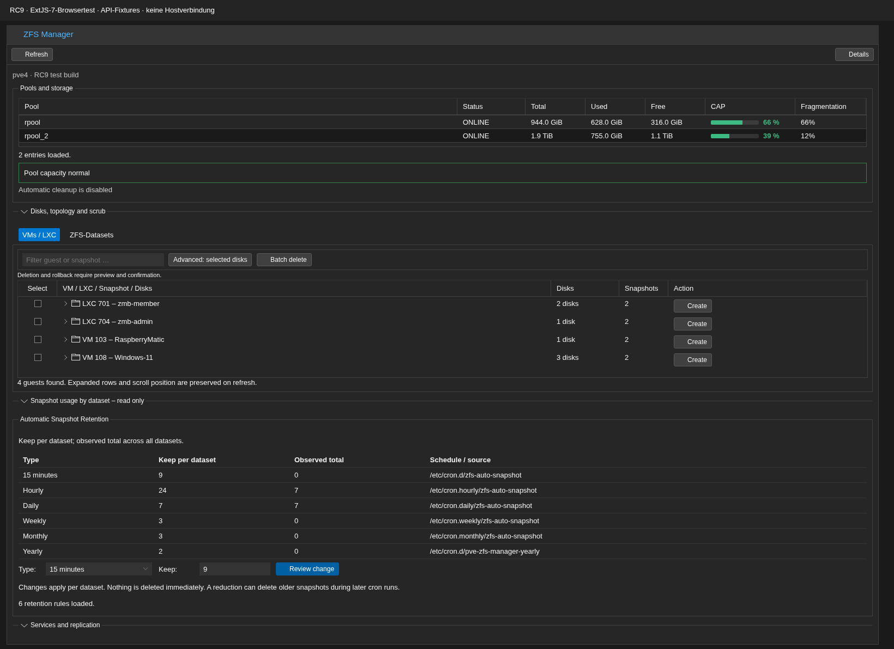

# BuMaVory ZFS Manager for Proxmox VE

Manage ZFS pools, VM/LXC snapshots and snapshot retention from the existing Proxmox
node interface on port 8006. Independent community software; not a Proxmox product.

[Deutsch](README.de.md) · [RC9 release](https://github.com/mbuse79/zfs-manager-pve/releases/tag/v1.0.0-34-rc9) · [Install RC9](docs/INSTALL-RC9.md) · [Security](SECURITY.md)

Development on this branch: [optional cluster installation](docs/CLUSTER-INSTALL.md)
with explicit target selection and confirmation. Not included in the published
RC9; real cluster testing and a new package approval remain outstanding.

## RC10 test package

`1.0.0-34~rc10`: optional cluster installation using a verified local distribution copy.
Not a public release; real cluster tests remain outstanding.
[German test instructions](docs/RC10-TESTANLEITUNG-DE.md).

## RC9: compact native interface

`1.0.0-34~rc9` keeps the tested package version. Pools appear first, CAP and FRAG
remain separate, technical details are collapsible, and the two snapshot tabs stay
available. The unified retention table distinguishes the per-dataset keep setting
from the observed total across datasets. German and English interfaces and CLI.

The operator confirmed the requested tests on the fresh test PVE and the existing
host on 15 November 2026 and authorized publication. The development session used
PVE 9.1.1 and 9.2.26. RC9 has 252 distinct local regression tests plus real ExtJS 7
browser checks with API fixtures; those do not establish support for every future
PVE layout or real offline-rescue hardware testing. See [validation](RELEASE-QA.md).

## Installation

RC9 is published as a **release candidate**. Download the full release ZIP and use
the verified bootstrap or `install-local.sh`, starting with `--check-only`.
The same path handles fresh installation and upgrade from RC7/RC8. Instructions and
checksum verification: **[docs/INSTALL-RC9.md](docs/INSTALL-RC9.md)**.

PVE 9.x is accepted without a minor/patch-version confirmation; structural checks
still stop on genuinely unknown integrations. PVE 8/10 are not enabled. The ZIP
includes the tested DEB unchanged, corresponding source/build files, installers,
Debian dependencies for amd64/all, their licenses and corresponding sources.
No general system/Proxmox upgrades or automatic package repairs are performed.
Unsupported competing snapshot schedulers are reported, not silently replaced.

The older stable [v1.0.0-32](https://github.com/mbuse79/zfs-manager-pve/releases/tag/v1.0.0-32)
remains unchanged. `quick-install.sh` still targets that stable release; it is not
the RC9 entry point. No downgrade of a newer installed manager is intended.

## Safety and licensing

Deletion and rollback require previews, authorization and confirmations. Keep
independent backups. Multi-disk operations are not atomic. Automatic **emergency
cleanup** defaults to OFF; existing explicitly enabled settings are retained.
AutoSnap's existing scheduled retention can remove older automatic snapshots at
later scheduled runs. Snapshot usage is not a prediction of reclaimable space.

Project contributions: [AGPL-3.0-only](LICENSE). Third-party rights remain separate;
see [notices](THIRD_PARTY_NOTICES.md) and [the scoped provenance review](CODE-PROVENANCE-REVIEW.md).
Maintainer: [BuMaVory Project](mailto:bumavory@buse.rocks).
